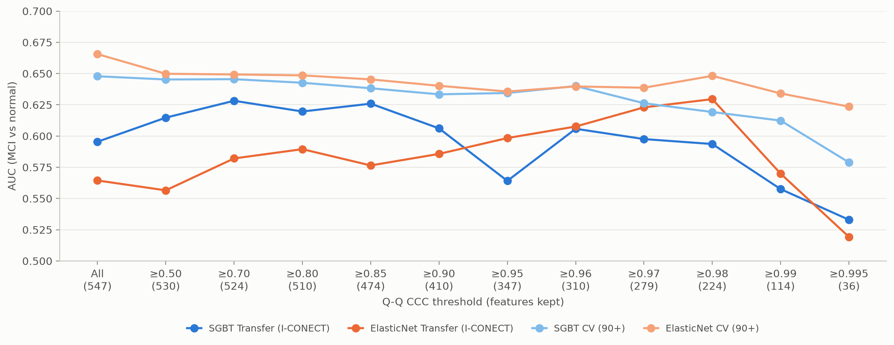
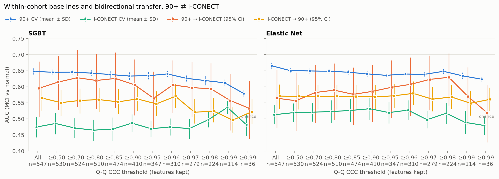
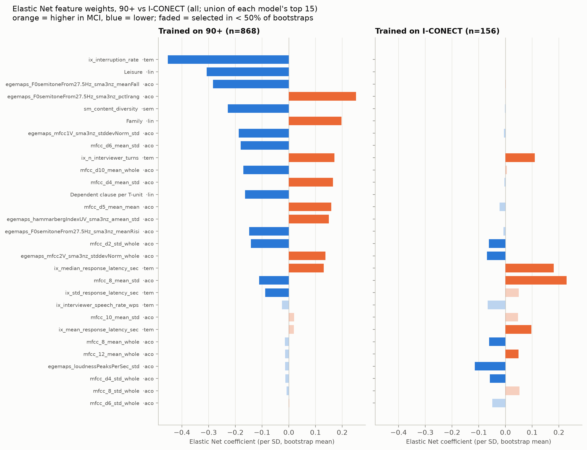

# CCC-threshold feature selection for 90+ → I-CONECT transfer — helps only by dropping a few badly-shifted features (2026-10-10)

Select features by their cross-cohort Q-Q CCC (from the
[2026-10-02 feature-distribution analysis](../2026-10-02-feature-distributions/)), train on 90+, test on
I-CONECT. **Hypothesis:** features whose robust-z-scored distributions match across cohorts should
transfer better. The CCC threshold is swept from "all features" to ≥ 0.995 and checked against random
subsets, within-cohort baselines and the reverse direction.

**Setup.** Subject-level mean features, MCI vs normal. 90+ `whisper-lv3-pyannote` (n=868, 456 MCI);
I-CONECT `sam_v0_ds2` (n=156, 82 MCI). 547 shared features (linguistic 99, temporal 24, semantic 4,
acoustic 420), each cohort robust-z-scored with its own median/IQR. Models: SGBT and Elastic Net (EN).
**Transfer** = fit on one cohort, predict the other (95% bootstrap CI). **CV** = StratifiedGroupKFold(5) × 10 seeds.

## Result 1 — transfer AUC rises slightly at moderate thresholds, then collapses

| CCC | n feat | SGBT 90+ CV | SGBT 90+ → IC [95% CI] | EN 90+ CV | EN 90+ → IC [95% CI] |
|---|---|---|---|---|---|
| all | 547 | 0.648 | 0.595 [0.51, 0.68] | 0.666 | 0.564 [0.47, 0.65] |
| ≥ 0.70 | 524 | 0.645 | **0.628** [0.54, 0.71] | 0.649 | 0.582 [0.49, 0.67] |
| ≥ 0.85 | 474 | 0.638 | 0.626 [0.54, 0.71] | 0.645 | 0.576 [0.48, 0.66] |
| ≥ 0.95 | 347 | 0.634 | 0.564 [0.47, 0.65] | 0.636 | 0.598 [0.50, 0.68] |
| ≥ 0.98 | 224 | 0.619 | 0.594 [0.50, 0.67] | 0.648 | **0.630** [0.54, 0.70] |
| ≥ 0.99 | 114 | 0.612 | 0.558 [0.46, 0.64] | 0.634 | 0.570 [0.48, 0.66] |
| ≥ 0.995 | 36 | 0.579 | 0.533 [0.44, 0.62] | 0.624 | 0.519 [0.43, 0.61] |

Full grid: `results/bidirectional_transfer_results.csv`.

- **Best threshold differs by model.** SGBT peaks at **≥ 0.70** (0.628, +0.033; plateau ≥ 0.50–0.85) and
  loses the gain from ≥ 0.95. EN peaks at **≥ 0.98** (0.630, +0.066; ≥ 0.96–0.98 all ≥ 0.608) and drops
  sharply at ≥ 0.99. There is no single best cut-off for both.
- The EN curve is noisy (0.557 at ≥ 0.50, 0.570 at ≥ 0.99), so its ≥ 0.98 peak may be a maximum of
  noise. The SGBT plateau is the more credible result.
- 90+ CV declines steadily as features are removed, so the filter costs source accuracy at every step.
- Every transfer CI is ~0.17 wide (n=156) and overlaps the all-features baseline.

## Result 2 — the gain is real vs random subsets, but not vs all features

- **Paired bootstrap vs all features** (all 11 thresholds): none differs significantly. Closest: EN ≥ 0.98,
  ΔAUC +0.065 [−0.003, +0.135], p = 0.059; SGBT ≥ 0.70, +0.033 [−0.004, +0.071], p = 0.084.
- **Permutation vs chance:** SGBT beats chance with all features (p = 0.020), at ≥ 0.50–0.90
  (p = 0.004–0.013) and at ≥ 0.96–0.98 (p = 0.014–0.023); not at ≥ 0.95 (p = 0.085) or ≥ 0.99. EN reaches
  p < 0.05 at ≥ 0.70, 0.80 and 0.90–0.98 (≥ 0.85: p = 0.054); not with all features, at ≥ 0.50 or ≥ 0.99.
- **Random-subset control** (200 random subsets of the same size per threshold, drawn from all features,
  family mix not matched): SGBT at ≥ 0.50–0.85 beats them (p = 0.005, the minimum with 200 draws; AUC
  0.615–0.628 vs ≈ 0.57); SGBT at ≥ 0.90 and above does not (p = 0.10–0.66). EN beats them only at
  ≥ 0.97 / ≥ 0.98 (p = 0.030 / 0.050).
- **EN's ≥ 0.97–0.98 range is the weak spot of this picture.** It beats chance and random subsets, but
  not the all-features baseline (p = 0.06), and it is one of ~90 uncorrected tests. SGBT and
  EN peak at different thresholds (≥ 0.70 vs ≥ 0.98), which fits noise around a flat curve.
- **Source of the SGBT gain:** the ≥ 0.50 cut drops only 17 features (16 `mfcc_d*_mean` plus
  `ix_interruption_rate`), which alone gives +0.019 of the +0.033 peak. The benefit is **removing a few
  badly-shifted features**, not **keeping only highly similar ones**.

## Result 3 — within-cohort baselines and the reverse direction

| train \ test | 90+ | I-CONECT |
|---|---|---|
| **90+** | CV 0.58–0.67 | transfer 0.52–0.63 |
| **I-CONECT** | transfer 0.50–0.58 | CV 0.47–0.54 |

- **I-CONECT within-cohort CV is at chance** at every threshold, so every 90+ → I-CONECT transfer AUC is
  above the matching I-CONECT CV: the 90+ model is better on I-CONECT than an I-CONECT model is.
- **I-CONECT → 90+ is weak and flat** (EN 0.55–0.58, SGBT 0.55–0.57 up to ≥ 0.96, chance above that).
  No threshold helps in this direction (best: EN ≥ 0.96, 0.579 vs 0.571).
- The direction asymmetry is confounded by training size (868 vs 156).

## Result 4 — feature weights: the I-CONECT model learns almost nothing

- **The I-CONECT model has no signal to weight.** OOB AUC is at chance (SGBT 0.48, EN 0.52); a
  156-subject 90+ subsample still reaches 0.60 / 0.61. EN weight agreement between the two models is
  ρ = 0.10 vs 0.36–0.47 for the small-n control.
- **Only two turn-timing features agree.** `ix_n_interviewer_turns` and `ix_median_response_latency_sec`
  are selected with the same sign (higher in MCI) by both EN models. Several MFCC features get opposite
  signs, e.g. `mfcc_8_mean_std`: −0.11 on 90+, +0.23 on I-CONECT (its largest weight).
- **`ix_interruption_rate`**, the strongest 90+ feature, is constant 0 in I-CONECT (no timestamp
  overlap), so it is unavailable at transfer time. It is removed at CCC < 0.5.

## Verdict

**CCC-based feature selection does not reliably improve 90+ → I-CONECT transfer.** Best thresholds:
**SGBT ≥ 0.70** (AUC 0.628), **EN ≥ 0.98** (AUC 0.630); neither beats all features significantly (closest: EN ≥ 0.98, p = 0.059) and
the two optima disagree. The SGBT gain comes from dropping ~17 shifted features (mostly delta-MFCC means).
Strict thresholds (≥ 0.99) hurt both source CV and transfer: distribution similarity is not diagnostic
information.

Recommendation: exclude the small set of clearly shifted features (CCC < 0.5) as a cleaning step; don't
use CCC as a selection criterion beyond that.

## Caveats

- One I-CONECT sample (n=156); the random-subset null varies features, not subjects.
- 12 thresholds × 2 models × several tests, not pre-registered, p-values uncorrected.
- CCC scores come from the same cohorts used for evaluation (labels were not used).
- ~90 p-values over thresholds × models × tests (`validity.py`), none corrected; borderline results
  (EN ≥ 0.97–0.98) should be read as suggestive only.
- Per-feature weights are noisy (bootstrap spreads exceed the means on I-CONECT); read them as patterns, not ranks.

## Follow-ups

- Test "drop CCC < 0.5" on another cohort pair or an ASR-matched re-run.
- Combine with harmonization / domain adaptation rather than selection alone.
- Transfer with temporal + linguistic features only (a rule that needs no target labels).