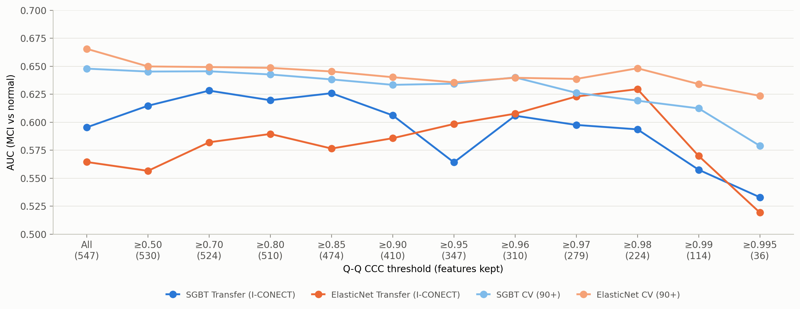
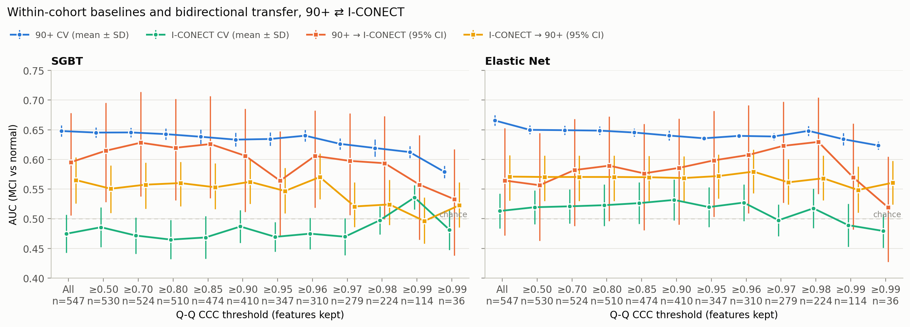
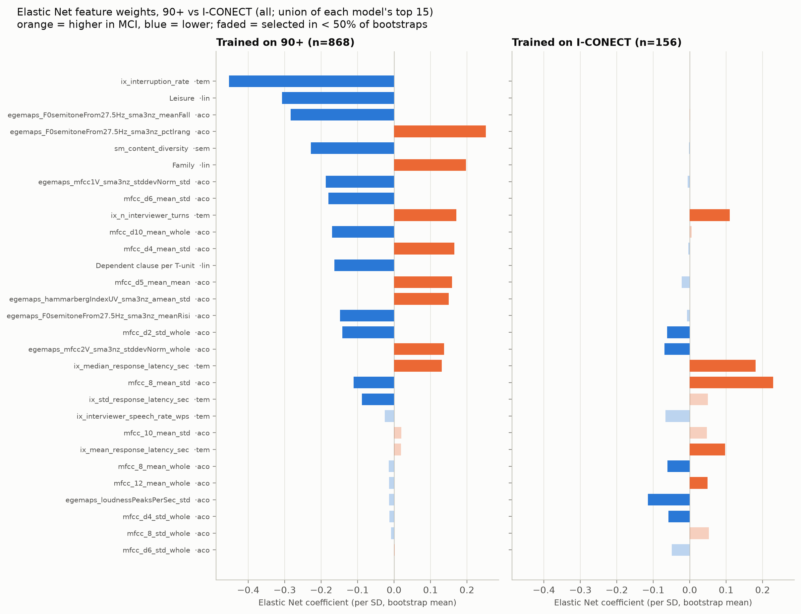

# CCC-threshold feature selection for 90+ → I-CONECT transfer — helps only by dropping a few badly-shifted features (2026-10-10)

This experiment selects features by their cross-cohort Q-Q CCC (from the
[2026-10-02 feature-distribution analysis](../2026-10-02-feature-distributions/)), trains on 90+ and
tests on I-CONECT. **Hypothesis:** features whose robust-z-scored distributions match across the two
cohorts should transfer better. The CCC threshold is swept from "all features" to ≥ 0.995. The result
is checked against random subsets of the same size, against within-cohort baselines, and in the
reverse direction (I-CONECT → 90+).

**Setup.** Subject-level mean features, MCI vs normal. 90+ `whisper-lv3-pyannote`, usable transcripts
(n=868, 456 MCI); I-CONECT `sam_v0_ds2` (n=156, 82 MCI). 547 features available in both cohorts
(linguistic 99 + temporal 24 + semantic 4 + acoustic 420; ≥80% non-NaN, acoustic ≥50%). Each cohort is
robust-z-scored with its own median/IQR. Models: SGBT (HistGradientBoosting) and Elastic Net.
**Transfer** = fit on all of one cohort, predict all of the other (single fit, 95% bootstrap CI).
**Within-cohort CV** = StratifiedGroupKFold(5) × 10 seeds, normalization fit on the training fold.
CCC grid: all, 0.50, 0.70, 0.80, 0.85, 0.90, 0.95, 0.96, 0.97, 0.98, 0.99, 0.995.

## Result 1 — transfer AUC rises slightly at moderate thresholds, then collapses



| CCC | n feat | SGBT 90+ CV | SGBT 90+ → IC [95% CI] | EN 90+ CV | EN 90+ → IC [95% CI] |
|---|---|---|---|---|---|
| all | 547 | 0.648 | 0.595 [0.51, 0.68] | 0.666 | 0.564 [0.47, 0.65] |
| ≥ 0.50 | 530 | 0.645 | 0.615 [0.53, 0.70] | 0.650 | 0.557 [0.46, 0.64] |
| ≥ 0.70 | 524 | 0.645 | **0.628** [0.54, 0.71] | 0.649 | 0.582 [0.49, 0.67] |
| ≥ 0.85 | 474 | 0.638 | 0.626 [0.54, 0.71] | 0.645 | 0.576 [0.48, 0.66] |
| ≥ 0.95 | 347 | 0.634 | 0.564 [0.47, 0.65] | 0.636 | 0.598 [0.50, 0.68] |
| ≥ 0.98 | 224 | 0.619 | 0.594 [0.50, 0.67] | 0.648 | **0.630** [0.54, 0.70] |
| ≥ 0.99 | 114 | 0.612 | 0.558 [0.46, 0.64] | 0.634 | 0.570 [0.48, 0.66] |
| ≥ 0.995 | 36 | 0.579 | 0.533 [0.44, 0.62] | 0.624 | 0.519 [0.43, 0.61] |

Full grid: `results/bidirectional_summary.csv`, CIs in `results/bidirectional_transfer_results.csv`.

- **SGBT** gains up to +0.033 at ≥ 0.50–0.85. From ≥ 0.95 on it is back at or below baseline
  (0.533–0.606).
- **Elastic Net** drifts up to 0.630 at ≥ 0.98, but the curve is noisy (≥ 0.85 → ≥ 0.99: 0.576, 0.586,
  0.598, 0.608, 0.623, 0.630, 0.570), not a clean trend.
- **90+ CV declines steadily** as features are removed (SGBT 0.648 → 0.579, EN 0.666 → 0.624). The
  filter costs source accuracy at every step.
- Every transfer CI is ~0.17 wide (n=156) and overlaps the all-features baseline.

## Result 2 — the gain is real vs random subsets, but not vs all features

**Paired bootstrap vs all features** (`results/paired_bootstrap.csv`; same 2000 I-CONECT resamples
for every subset; original 7-condition grid): **no threshold differs significantly from all features.**
The largest is SGBT ≥ 0.70, ΔAUC +0.033 [−0.004, +0.071], p = 0.08.

**Permutation test vs chance** (`results/permutation.csv`; 5000 label permutations): SGBT transfer
beats chance with all features (p = 0.020) and at ≥ 0.50–0.90 (p = 0.004–0.013); not at ≥ 0.95
(p = 0.085). Elastic Net reaches p < 0.05 only at ≥ 0.70 / 0.80 / 0.90 / 0.95.

**Random-subset control** (`results/random_subset_summary.csv`). The transfer model was refit on 200
random feature subsets of the same size per threshold — *stratified* (same per-family counts) and
*unstratified* (same total) — and the CCC subset's I-CONECT AUC was ranked against them:

| | stratified p | unstratified p | CCC AUC vs random mean |
|---|---|---|---|
| SGBT ≥ 0.50 / 0.70 / 0.80 | 0.005–0.010 | 0.005 | 0.615–0.628 vs ≈ 0.57 |
| SGBT ≥ 0.85 | 0.035 | 0.005 | 0.626 vs 0.574–0.580 |
| SGBT ≥ 0.90 / 0.95 | 0.22 / 0.80 | 0.10 / 0.66 | n.s. |
| Elastic Net, every threshold | 0.07–0.85 | 0.11–0.92 | n.s. |

(p = 0.005 is the floor at 200 draws.)

**Where the SGBT gain comes from.** The ≥ 0.50 cut drops only 17 features: 16 `mfcc_d*_mean`
(delta-MFCC means, which mainly track recording/channel conditions) plus `ix_interruption_rate`. That
alone gives more than half of the SGBT gain (+0.019 of the +0.033 peak). The benefit is **removing a
few badly-shifted features**, not **keeping only highly similar ones**.

## Result 3 — within-cohort baselines and the reverse direction



| train \ test | 90+ | I-CONECT |
|---|---|---|
| **90+** | CV 0.58–0.67 | transfer 0.52–0.63 |
| **I-CONECT** | transfer 0.50–0.58 | CV 0.47–0.54 |

- **I-CONECT within-cohort CV is at chance** at every threshold (SGBT 0.47–0.54, EN 0.48–0.53, seed
  SD ≈ 0.03). With n=156 these features can't learn the I-CONECT labels locally. Every 90+ → I-CONECT
  transfer AUC is above the matching I-CONECT CV. **The 90+ model is better on I-CONECT than an
  I-CONECT model is.**
- **I-CONECT → 90+ is weak and flat**: EN 0.55–0.58 with CI lower bound > 0.5 throughout; SGBT
  0.55–0.57 up to ≥ 0.96, then at chance (0.50–0.52) above that. It does not improve with the CCC filter.
- The asymmetry between directions is confounded by training size (868 vs 156).

## Result 4 — feature weights: the I-CONECT model learns almost nothing, and transfer is hurt by direction flips

`feature_importance.py` compares what a 90+-trained and an I-CONECT-trained model weight (all
features and CCC ≥ 0.50; 50 bootstraps per cohort). Weights are Elastic Net coefficients (signed,
bootstrap mean, with selection frequency) and OOB permutation importance (ΔAUC) for both models.
The 90+ model is also scored by permutation importance on I-CONECT (*transfer importance*). A
**small-n control** reruns the I-CONECT procedure on 10 random 156-subject 90+ subsamples, to separate
"different cohort" from "small sample". Outputs: `results/feature_importance/`, figures `fi_*.png`.



**The I-CONECT model has no signal to weight.** Its OOB AUC is at chance (SGBT 0.48, EN 0.52). A
156-subject 90+ subsample still reaches 0.60 / 0.61, so this is not only the sample size. EN keeps 146
features in ≥ 50% of bootstraps on 90+ but only 13 on I-CONECT, with smaller coefficients (max |β|
0.45 vs 0.23). SGBT importances on I-CONECT all have SD larger than the mean
(`fi_weights_sgbt_all.png`). The I-CONECT top features are mostly noise and shouldn't be read as
I-CONECT markers.

| Elastic Net (all features) | 90+ model β (sel.) | I-CONECT model β (sel.) |
|---|---|---|
| `ix_interruption_rate` | −0.45 (1.00) | n/a (constant 0 in I-CONECT) |
| `Leisure` | −0.31 (1.00) | 0 (0.00) |
| `sm_content_diversity` | −0.23 (0.92) | 0 (0.02) |
| `ix_n_interviewer_turns` | **+0.17** (0.82) | **+0.11** (0.66) |
| `ix_median_response_latency_sec` | **+0.13** (0.88) | **+0.18** (0.90) |
| `mfcc_8_mean_std` | **−0.11** (0.82) | **+0.23** (0.92) |
| `egemaps_mfcc2V_sma3nz_stddevNorm_whole` | **+0.14** (0.92) | **−0.07** (0.70) |

- **The two models' weights don't agree, beyond what small n explains.** EN \|β\| Spearman ρ between the
  90+ and I-CONECT models is 0.10 (CCC ≥ 0.50: 0.12). The small-n control gives 0.36–0.47 (all 10 above
  I-CONECT). Permutation importance is too noisy at n=156 to separate them (control ρ ≈ 0.09 on its
  own). Since the I-CONECT model is at chance, this mostly means it doesn't recover the 90+ pattern,
  not that I-CONECT has its own distinct markers.
- **Only two features are selected by both EN models with the same sign**, both turn-taking timing:
  `ix_n_interviewer_turns` and `ix_median_response_latency_sec` (higher in MCI in both cohorts).
- **Sign flips are MFCC-type acoustic features.** For example, `mfcc_8_mean_std` is −0.11 on 90+ and
  +0.23 on I-CONECT, the I-CONECT model's largest weight.
- **Univariately, the signal is shared.** Among features with a clear 90+ effect, MCI-direction
  agreement in I-CONECT rises with effect size: 73% (\|AUC−0.5\| ≥ 0.03, n=251), 84% (≥ 0.05, n=137),
  100% (≥ 0.08, n=19). By family (≥ 0.05): linguistic 41/41, temporal 16/16, acoustic 72%.
  (`ix_interruption_rate` is excluded: it is constant in I-CONECT and has no direction.) The strongest
  shared effects are fluency: shorter sentences and utterances (`Mean length of sentence` 0.378 on 90+ /
  0.428 on I-CONECT, `pt_mean_words_per_utt`) and more pausing (`pt_long_pause_per_min`, `pt_pause_ratio`).
  They are weaker in I-CONECT. This is consistent with Result 3: the signal exists in I-CONECT but is
  too weak for 156 subjects to find among 547 features, while 868 subjects can.
- **Exception:** `ix_interruption_rate` is the strongest 90+ feature (univariate AUC 0.368, largest EN β,
  SGBT importance 0.020 vs ≤ 0.005 for any other feature) but is **constant 0 for all 156 I-CONECT
  subjects** (90+ mean 0.24), most likely because I-CONECT turn timestamps never overlap
  ([2026-10-02, Result 2](../2026-10-02-feature-distributions/)). The 0.500 AUC and zero I-CONECT
  coefficient are therefore not "no signal", the feature cannot carry any. The 90+ model's single
  strongest feature is unavailable at transfer time. It is one of the 17 features removed at CCC < 0.5
  (no CCC is defined for a constant).

**What hurts transfer is a feature–label direction flip, not distribution shift.** Among the 90+ EN
model's top-100 features, those whose univariate direction flips in I-CONECT have mean transfer
importance −0.0024 vs +0.0024 for the rest (n = 32 vs 67; Mann-Whitney p = 1e-4; SGBT same direction, p = 0.42).
The constant `ix_interruption_rate` is excluded from this comparison.
The worst is `mfcc_d5_mean_mean` (univariate AUC 0.553 on 90+ → 0.391 on I-CONECT; EN transfer
importance −0.020). Transfer importance is uncorrelated with Q-Q CCC (ρ = 0.04 / −0.05). None of the
20 most harmful features has CCC < 0.5 (`mfcc_d5_mean_mean` has CCC 0.66). Conversely, three
delta-MFCC means removed at CCC < 0.5 (`mfcc_d6_mean_mean`, `d3`, `d11`) are among EN's most *helpful*
features on I-CONECT, despite univariate AUC ≈ 0.49. They likely adjust for channel differences
inside the linear model. This fits CCC ≥ 0.50 helping SGBT but not EN (0.564 → 0.557). By family,
temporal features only help EN transfer (summed importance +0.047 / −0.000). Acoustic features are
net harmful for SGBT (+0.14 / −0.27).

## Verdict

**CCC-based feature selection does not reliably improve 90+ → I-CONECT transfer.** Moderate thresholds
(≥ 0.50–0.85) give SGBT a +0.02–0.03 gain that is unlikely for random subsets of the same size. That
gain is not significant against all features, and it comes from dropping ~17 shifted features (mostly
delta-MFCC means), not from keeping the most similar ones. Strict thresholds (≥ 0.99)
**hurt** both source CV and transfer: distribution similarity is not the same as diagnostic
information.

Practical recommendation: for 90+ → I-CONECT transfer, **exclude the small set of clearly shifted
features (CCC < 0.5)** as a cleaning step. Don't use CCC as a selection criterion beyond that.

The feature-weight analysis (Result 4) explains why. The 90+ and I-CONECT models share almost no
weights because the I-CONECT model is at chance, not because the cohorts have different markers. The
transferable signal is a fluency / pausing / turn-timing pattern with the same direction in both
cohorts. The features that hurt transfer are mostly MFCC-type acoustic features whose relation to MCI
flips sign, which a marginal-distribution score like CCC cannot detect.

## Caveats

- One I-CONECT sample (n=156). The random-subset null varies the feature set, not the subjects. Every
  transfer CI is ~0.17 wide.
- Many nested comparisons (12 thresholds × 2 models × several tests). The thresholds were not
  pre-registered and the p-values are uncorrected.
- The CCC scores come from the same two cohorts used for evaluation, so the selection is not
  independent of the target-cohort features (labels were not used).
- `permutation.csv` and `paired_bootstrap.csv` cover the original 7-condition grid (up to ≥ 0.95).
  Rerunning `submit_bidirectional.sh` extends them to all 12 thresholds.
- Training sizes are asymmetric (868 vs 156), which confounds direction comparisons.
- Per-feature transfer importances are ±0.01–0.02 AUC from a single fit with no CI. Read family-level
  and flip-vs-no-flip summaries, not individual feature ranks. Direction flips are measured on
  I-CONECT labels, so selecting features by them would leak target labels.

## Follow-ups

- Test "drop CCC < 0.5" as a fixed cleaning rule on another cohort pair, or on an ASR-matched re-run,
  to check it isn't specific to this sample.
- Combine with harmonization / domain adaptation rather than selection alone.
- Transfer with temporal + linguistic features only (a label-free rule suggested by Result 4), and add
  bootstrap CIs to transfer importance to check whether `mfcc_d5_mean_mean`-type flips are stable.

## Reproduce

```bash
cd ~/90plus/language-marker-commons
D=docs/analysis/cross-cohort/2026-10-10-ccc-threshold-transfer
sbatch $D/submit_bidirectional.sh      # bidirectional.py → plot_bidirectional.py → stats.py
sbatch $D/submit_random.sh             # random_subset.py
python $D/plot_combined.py
python $D/build_report.py                # standalone external report → report/ (aggregate results only)
sbatch $D/submit_feature_importance.sh # feature_importance.py → plot_feature_importance.py
```

Requires scikit-learn < 1.9: in 1.9.1, HistGradientBoosting is ~8× slower here. CCC scores are read from
`../2026-10-02-feature-distributions/results/normalized/feature_shape_stats.csv`. Feature parquets are
gitignored (local/turbo). Only aggregate results are committed. Per-seed CV rows, per-subject
predictions and raw random draws are written by the scripts but git-ignored.

| file | role |
|---|---|
| `cohorts.py` | data loading, availability filter, CCC selection (shared) |
| `models.py`, `evaluate.py` | model factories; robust z-score, within-cohort CV, transfer |
| `bidirectional.py` | main experiment: 2 × 2 train × test matrix per CCC threshold |
| `random_subset.py` | random-subset control |
| `stats.py` | permutation test + paired bootstrap (90+ → I-CONECT) |
| `feature_importance.py` | 90+-trained vs I-CONECT-trained feature importance (OOB permutation, EN coef, transfer permutation, n-matched 90+ control) → `results/feature_importance/` |
| `build_report.py`, `report_template.html` | self-contained HTML report for external readers (inline SVG charts, no external requests) → `report/` |
| `plot_style.py`, `plot_*.py` | shared style; AUC and `fi_*` importance figures → `results/figures/` |
| `results/feature_subsets/` | feature names per CCC threshold |
